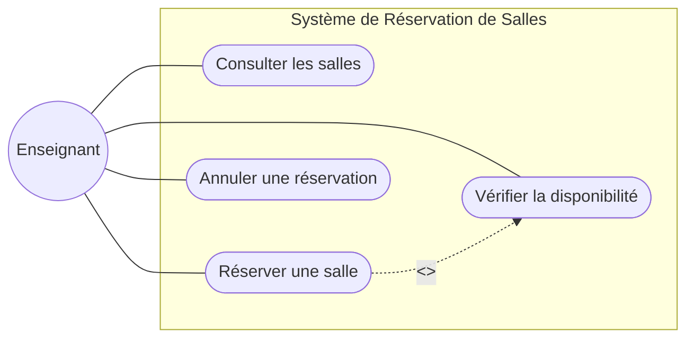
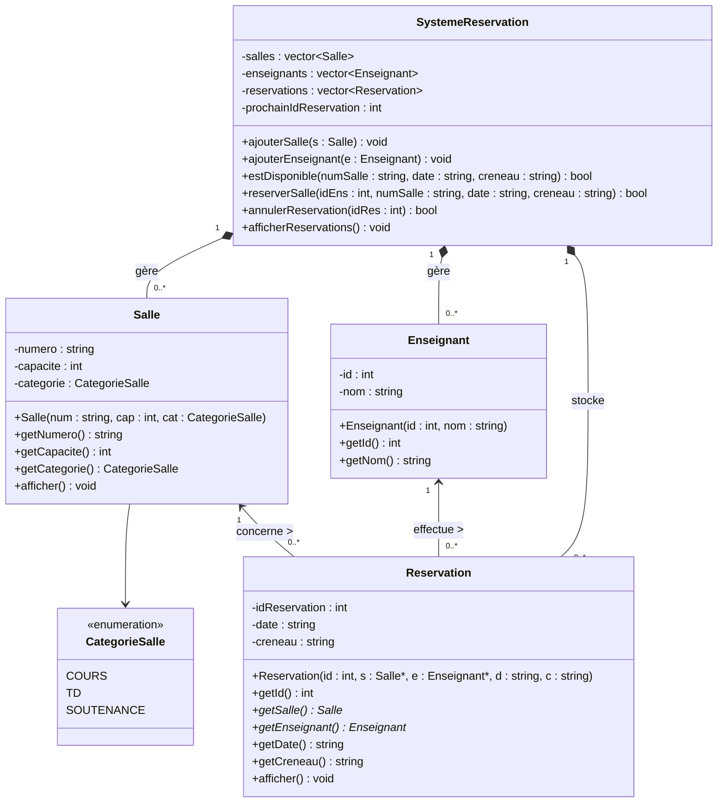
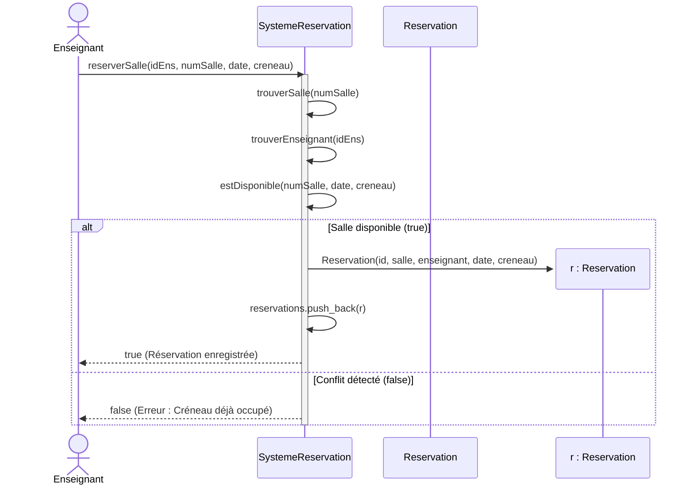

Voici le contenu complet du fichier README.md, structuré et prêt à être copié-collé dans votre projet. Il intègre l'analyse, les trois diagrammes UML au format Mermaid (compatibles GitHub et GitLab), ainsi que le code C++.
markdown
# 🏫 Système de Réservation de Salles Universitaires (UML & C++)

Projet complet d'analyse, de modélisation UML et d'implémentation en C++ pour la gestion des salles d'un département universitaire (cours, travaux dirigés et soutenances).

---

## 🎯 Objectifs et Fonctionnalités

* **Modélisation UML complète :** Identification des classes, diagramme de cas d'utilisation, diagramme de classes et diagramme de séquence.
* **Vérification de disponibilité :** Contrôle de l'occupation d'une salle pour une date et un créneau horaire précis.
* **Gestion des réservations :** Enregistrement sécurisé avec identifiant unique et annulation d'une réservation.
* **Respect des contraintes métier :** Blocage automatique des réservations conflictuelles (double réservation sur un même créneau).

---

## 🧩 1. Identification des Classes

L'architecture repose sur quatre classes principales assurant une séparation claire des responsabilités :

1. **`Salle`** : Représente une salle physique avec un numéro unique, une capacité d'accueil et une catégorie (`COURS`, `TD`, `SOUTENANCE`).
2. **`Enseignant`** : Représente un membre du corps enseignant identifié par un numéro et un nom.
3. **`Reservation`** : Classe d'association liant un `Enseignant` et une `Salle` pour une date et un créneau horaire précis.
4. **`SystemeReservation`** : Classe de contrôle gérant les collections d'objets (`std::vector`) et l'application des règles métier.

---

## 📊 2. Modélisation UML

### Diagramme de Cas d'Utilisation



### Diagramme de Classes



### Diagramme de Séquence (Réservation d'une salle)



---

## 💻 3. Implémentation en C++

Enregistrez le code suivant dans un fichier nommé `main.cpp` :

```cpp
#include <iostream>
#include <vector>
#include <string>
#include <algorithm>

enum class CategorieSalle {
    COURS,
    TD,
    SOUTENANCE
};

std::string categorieToString(CategorieSalle cat) {
    switch (cat) {
        case CategorieSalle::COURS: return "Cours";
        case CategorieSalle::TD: return "Travaux Diriges";
        case CategorieSalle::SOUTENANCE: return "Soutenance";
        default: return "Inconnue";
    }
}

class Salle {
private:
    std::string numero;
    int capacite;
    CategorieSalle categorie;

public:
    Salle(std::string num, int cap, CategorieSalle cat)
        : numero(num), capacite(cap), categorie(cat) {}

    std::string getNumero() const { return numero; }
    int getCapacite() const { return capacite; }
    CategorieSalle getCategorie() const { return categorie; }

    void afficher() const {
        std::cout << "Salle " << numero << " [" << categorieToString(categorie) 
                  << "] - Capacite : " << capacite << " places.\n";
    }
};

class Enseignant {
private:
    int id;
    std::string nom;

public:
    Enseignant(int id, std::string nom) : id(id), nom(nom) {}

    int getId() const { return id; }
    std::string getNom() const { return nom; }
};

class Reservation {
private:
    int idReservation;
    const Salle* salle;
    const Enseignant* enseignant;
    std::string date;
    std::string creneau;

public:
    Reservation(int id, const Salle* s, const Enseignant* e, std::string d, std::string c)
        : idReservation(id), salle(s), enseignant(e), date(d), creneau(c) {}

    int getId() const { return idReservation; }
    const Salle* getSalle() const { return salle; }
    const Enseignant* getEnseignant() const { return enseignant; }
    std::string getDate() const { return date; }
    std::string getCreneau() const { return creneau; }

    void afficher() const {
        std::cout << "Reservation #" << idReservation << " | Salle: " << salle->getNumero()
                  << " | Par: " << enseignant->getNom() << " | Le: " << date 
                  << " (" << creneau << ")\n";
    }
};

class SystemeReservation {
private:
    std::vector<Salle> salles;
    std::vector<Enseignant> enseignants;
    std::vector<Reservation> reservations;
    int prochainIdReservation = 1;

    const Salle* trouverSalle(const std::string& numeroSalle) const {
        for (const auto& s : salles) {
            if (s.getNumero() == numeroSalle) return &s;
        }
        return nullptr;
    }

    const Enseignant* trouverEnseignant(int idEnseignant) const {
        for (const auto& e : enseignants) {
            if (e.getId() == idEnseignant) return &e;
        }
        return nullptr;
    }

public:
    void ajouterSalle(const Salle& s) { salles.push_back(s); }
    void ajouterEnseignant(const Enseignant& e) { enseignants.push_back(e); }

    bool estDisponible(const std::string& numeroSalle, const std::string& date, const std::string& creneau) const {
        for (const auto& res : reservations) {
            if (res.getSalle()->getNumero() == numeroSalle &&
                res.getDate() == date &&
                res.getCreneau() == creneau) {
                return false;
            }
        }
        return true;
    }

    bool reserverSalle(int idEnseignant, const std::string& numeroSalle, const std::string& date, const std::string& creneau) {
        const Salle* salle = trouverSalle(numeroSalle);
        const Enseignant* enseignant = trouverEnseignant(idEnseignant);

        if (!salle || !enseignant) {
            std::cout << "[Erreur] Salle ou enseignant introuvable.\n";
            return false;
        }

        if (!estDisponible(numeroSalle, date, creneau)) {
            std::cout << "[Conflit] La salle " << numeroSalle << " est deja reservee le " 
                      << date << " sur le creneau " << creneau << ".\n";
            return false;
        }

        Reservation nouvelleRes(prochainIdReservation++, salle, enseignant, date, creneau);
        reservations.push_back(nouvelleRes);
        std::cout << "[Succes] Reservation #" << nouvelleRes.getId() << " enregistree pour " 
                  << enseignant->getNom() << " (Salle " << numeroSalle << ").\n";
        return true;
    }

    bool annulerReservation(int idReservation) {
        auto it = std::remove_if(reservations.begin(), reservations.end(),
            [idReservation](const Reservation& res) {
                return res.getId() == idReservation;
            });

        if (it != reservations.end()) {
            reservations.erase(it, reservations.end());
            std::cout << "[Succes] Reservation #" << idReservation << " annulee.\n";
            return true;
        }

        std::cout << "[Erreur] Aucune reservation trouvee avec l'ID #" << idReservation << ".\n";
        return false;
    }

    void afficherReservations() const {
        std::cout << "\n--- Liste des reservations actives ---\n";
        if (reservations.empty()) {
            std::cout << "Aucune reservation en cours.\n";
            return;
        }
        for (const auto& res : reservations) {
            res.afficher();
        }
        std::cout << "--------------------------------------\n\n";
    }
};

int main() {
Utilisez le code avec précaution.
SystemeReservation systeme;
systeme.ajouterSalle(Salle("A101", 120, CategorieSalle::COURS));
systeme.ajouterSalle(Salle("B204", 30, CategorieSalle::TD));
systeme.ajouterSalle(Salle("S01", 15, CategorieSalle::SOUTENANCE));
systeme.ajouterEnseignant(Enseignant(1, "Dr. Diallo"));
systeme.ajouterEnseignant(Enseignant(2, "Prof. Kouassi"));
systeme.reserverSalle(1, "A101", "2026-11-15", "08h00-10h00");
systeme.reserverSalle(2, "A101", "2026-11-15", "08h00-10h00"); // Bloqué (conflit)
systeme.reserverSalle(2, "A101", "2026-11-15", "10h00-12h00");
systeme.afficherReservations();
systeme.annulerReservation(1);
systeme.reserverSalle(2, "A101", "2026-11-15", "08h00-10h00"); // Réussi après annulation
systeme.afficherReservations();
return 0;
}
```

🚀 4. Compilation et Exécution


Prérequis

• Compilateur C++ compatible C++11 minimum (g++, clang++, ou MSVC).

Commandes

```bash

Compilation

g++ -std=c++11 -Wall -o reservation main.cpp

Exécution

./reservation
```

Sortie console attendue

```text
[Succes] Reservation #1 enregistree pour Dr. Diallo (Salle A101).
[Conflit] La salle A101 est deja reservee le 2026-11-15 sur le creneau 08h00-10h00.
[Succes] Reservation #2 enregistree pour Prof. Kouassi (Salle A101).

--- Liste des reservations actives ---
Reservation #1 | Salle: A101 | Par: Dr. Diallo | Le: 2026-11-15 (08h00-10h00)
Reservation #2 | Salle: A101 | Par: Prof. Kouassi | Le: 2026-11-15 (10h00-12h00)

[Succes] Reservation #1 annulee.
[Succes] Reservation #3 enregistree pour Prof. Kouassi (Salle A101).

--- Liste des reservations actives ---
Reservation #2 | Salle: A101 | Par: Prof. Kouassi | Le: 2026-11-15 (10h00-12h00)
Reservation #3 | Salle: A101 | Par: Prof. Kouassi | Le: 2026-11-15 (08h00-10h00)

```

<FollowUp>
Souhaitez-vous que je :
* Génère directement les fichiers **`README.md`** et **`main.cpp`** téléchargeables pour votre projet ?
* Sépare le code C++ en **fichiers d'en-tête (`.hpp`) et sources (`.cpp`)** pour une architecture multi-fichiers plus professionnelle ?
</FollowUp>
